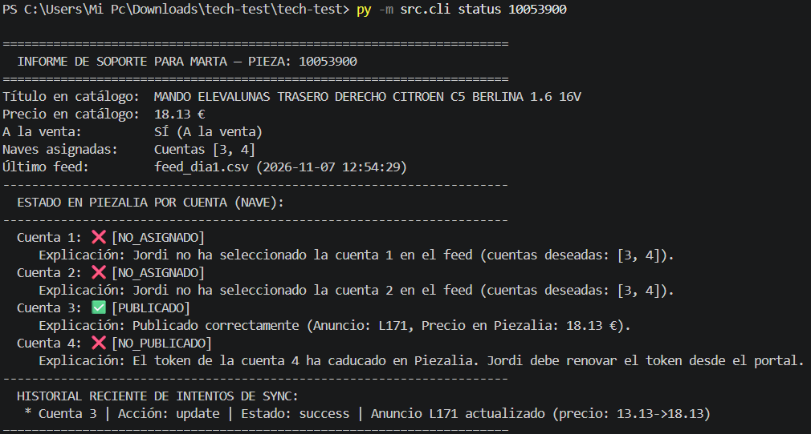

# Catálogo de Desguaces Rovira en Piezalia — Portal Hero

Solución técnica para la sincronización robusta y desatendida entre el catálogo de Desguaces Rovira y el marketplace Piezalia (distribuido en 4 cuentas/naves).

Implementado bajo los principios de **Clean Architecture**, con **SQLAlchemy 2.0 ORM** (Data Mapper no invasivo) y soporte dual: PostgreSQL para entornos productivos/Docker y SQLite para desarrollo y pruebas locales inmediatas.

---

## 🏗️ Arquitectura del Proyecto

El código está estructurado en capas estrictamente desacopladas:

```
docs/                      # Enunciado, decisiones, plan y contexto
├── assets/                # Imágenes de documentación
data/                      # Feeds CSV de ejemplo
src/
├── domain/                  # Entidades puras (Product, Listing, SyncAction) y excepciones
├── application/             # Casos de uso (ImportFeed, SyncCatalog, ProductStatus)
├── infrastructure/          # Adaptadores concretos
│   ├── database/            # SQLAlchemy 2.0 ORM, repositorios y migraciones
│   ├── portal/              # Cliente HTTP Piezalia con reintentos y tolerancia a fallos
│   ├── csv/                 # Parser robusto del feed CSV
│   └── api/                 # Endpoint FastAPI complementario para soporte
├── config.py                # Configuración y carga de accounts.csv
└── cli.py                   # CLI principal para ejecución en cron
```

`README.md`, `Dockerfile`, `docker-compose.yml` y `requirements.txt` se mantienen en
la raíz para que las herramientas y los comandos habituales sigan encontrándolos.
La documentación adicional está en `docs/`; los feeds CSV de ejemplo están en
`data/` y `accounts.csv` permanece en la raíz.

---

## 🚀 Puesta en Marcha

### Opción A: Con Docker Compose (Recomendado para evaluación)

Levanta PostgreSQL, el simulador de Piezalia y la aplicación:

```bash
# 1. Iniciar servicios en segundo plano (BD y simulador de Piezalia)
docker compose up -d db portal

# 2. Importar el primer feed diario:
docker compose run app import /app/data/feed_dia1.csv

# 3. Sincronizar catálogo con Piezalia:
docker compose run app sync

# 4. Consultar el estado de una pieza para soporte (Marta):
docker compose run app status 10053900

# 5. Importar el segundo día (con cambios de precio, bajas y anomalías):
docker compose run app import /app/data/feed_dia2.csv
docker compose run app sync
```

---

### Opción B: Ejecución Local directa (sin Docker)

La solución incluye un fallback transparente a SQLite (`sqlite:///rovira.db`) para probarla de inmediato en cualquier máquina:

1. **Instalar dependencias**:
   ```bash
   pip install -r requirements.txt -r portal-sim/requirements.txt
   ```

2. **Arrancar el simulador de Piezalia** (en una terminal):
   * En Linux / macOS:
     ```bash
     cd portal-sim
     PORTAL_CONFIG="$PWD/config/default.json" python -m uvicorn app:app --port 8080
     ```
   * En Windows PowerShell:
     ```powershell
     $env:PYTHONUTF8="1"
     $env:PORTAL_CONFIG="$PWD\portal-sim\config\default.json"
     cd portal-sim
     python -m uvicorn app:app --port 8080
     ```

3. **Ejecutar los comandos** (en otra terminal en la raíz del proyecto):
   ```bash
   python -m src.cli import data/feed_dia1.csv
   python -m src.cli sync
   python -m src.cli status 10053900
   ```

---

## 📋 Comandos Disponibles

### 1. `import <feed_path>`
Lee el fichero CSV exportado por el ERP de Rovira y actualiza el catálogo en base de datos.
* **Protección ante feeds truncados**: Si el feed contiene menos del 50% de productos respecto al catálogo anterior, aborta con `TruncatedFeedError` para evitar despublicaciones masivas por error del ERP antiguo.
* **Tolerancia a fallos**: Omite líneas vacías, detecta precios con formato incorrecto (ej. coma `"443,90"` o textos) y limpia espacios en `store_id` (ej. `' 2 | 3 '`).
* **Truncado de títulos**: Ajusta títulos a 80 caracteres para garantizar compatibilidad con Piezalia (OpenAPI 422).

### 2. `sync`
Deja cada cuenta de Piezalia exactamente como dice el catálogo activo.
* **Actualizar antes que borrar**: Si el producto ya existe en la cuenta, realiza `PUT` en lugar de borrar y recrear, preservando el `listing_id`, visitas y posicionamiento.
* **Ahorro de peticiones**: Si el título y precio no han cambiado, omite la llamada `PUT`.
* **Respeto a anuncios manuales**: Anuncios con `sku == null` (publicados a mano por Jordi) **nunca se tocan**.
* **Retirada inmediata**: Si una pieza ya no viene en el feed, se retira (`DELETE`) para evitar vender piezas ya despachadas en mostrador.
* **Aislamiento por cuenta**: Si la cuenta 4 tiene el token expirado, registra el error y **continúa sincronizando las cuentas 1, 2 y 3**.

### 3. `status <product_id>`
Herramienta de diagnóstico para soporte (Marta). Muestra un informe estructurado con el estado de la pieza en catálogo y en cada una de las 4 cuentas de Piezalia, indicando motivos exactos (ej. *«Token de la cuenta 4 caducado: Jordi debe renovar en el portal»* o *«Jordi no seleccionó la cuenta 4 en el feed»*).



---

## 🧪 Pruebas Automatizadas

La suite de tests unitarios utiliza la biblioteca estándar de Python y no requiere base de datos externa ni red:

```bash
python -m unittest discover -v tests
```

* `tests/test_feed_parser.py`: Validación de casos límite del CSV (líneas vacías, comas, espacios, UTF-8 BOM).
* `tests/test_import_feed.py`: Pruebas de importación y aborto por feed truncado.
* `tests/test_sync_catalog.py`: Pruebas de reconciliación (altas, bajas, actualizaciones, anuncios manuales, tokens caducados).
* `tests/test_product_status.py`: Pruebas del informe de diagnóstico para soporte.
* `tests/test_portal_client.py`: Resiliencia HTTP (401 token_expired, 429 rate limit con Retry-After, 503 backoff, paginación).
* `tests/test_cli.py`: Validación de argumentos y códigos de salida.

---

## 🌐 API Web Opcional (FastAPI)

Para que el equipo de soporte pueda consultar el estado desde un navegador web o Swagger UI:

```bash
python -m uvicorn src.infrastructure.api.app:app --port 8000
```
* Documentación interactiva Swagger UI: `http://localhost:8000/docs`
* Endpoint de estado: `GET http://localhost:8000/status/{product_id}`
