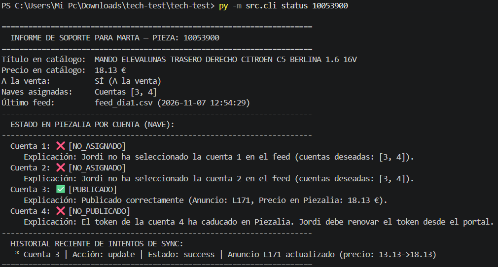

# Decisiones que he ido tomando

Aquí resumo las decisiones que he tomado durante el desarrollo de la prueba técnica, sobre todo en aquellas partes donde el enunciado dejaba margen de decisión o donde me he encontrado casos especiales en los datos.

---

### 1. Arquitectura y tecnologías: Clean Architecture con SQLAlchemy 2.0
Para organizar el proyecto he seguido **Clean Architecture**. Quería que la lógica de negocio (las reglas de Rovira y Piezalia) estuviese completamente separada de la base de datos y de las llamadas HTTP.

Al plantearme el framework y el ORM, valoré usar Django, pero para un proceso que corre desatendido en un cron me parecía meter demasiada sobrecarga y acoplamiento (Django te empuja a usar su patrón *Active Record* donde los modelos dependen directamente del framework). En su lugar he preferido usar **SQLAlchemy 2.0**, que implementa *Data Mapper*:
* Mis entidades de dominio (`Product`, `Listing`) son clases puras de Python.
* Toda la persistencia vive en la capa de infraestructura.
* Además, he dejado preparado el sistema para funcionar tanto con **PostgreSQL** (en Docker) como con **SQLite** en local, para que quien revise la prueba pueda arrancarla al segundo sin tener que pelearse instalando bases de datos.
* También he añadido una pequeña API con **FastAPI** por si Marta o el equipo prefieren consultar el estado de una pieza desde el navegador o Swagger UI (`/docs`).

---

### 2. Feeds a medias: ¿cómo evitar despublicar el catálogo por error?
El enunciado avisa de que el software de gestión de Rovira es viejo y a veces saca el CSV a medias. Si el feed es la verdad absoluta y nos llega un archivo con 5 piezas en vez de 600, una sincronización normal borraría casi todo el catálogo de Piezalia (con el coste de visitas y posicionamiento que eso supone).

Para protegernos de esto, he añadido una comprobación antes de guardar nada: si el feed que entra tiene menos del 50% de las piezas que ya teníamos activas, considero que el fichero viene truncado. En ese caso se lanza un error crítico (`TruncatedFeedError`), se rechaza la importación y el catálogo anterior se queda tal cual hasta que llegue un feed completo.

---

### 3. Líneas raras en el feed del día 2 (comas en precios, líneas vacías...)
Revisando `feed_dia2.csv` vi varias trampas:
* **Líneas vacías**: Las ignoro directamente sin que cuenten como error.
* **Espacios en las cuentas** (como `' 2 | 3 '`): Las limpio con `strip()` para que se asignen bien.
* **Precios con coma o texto** (como `"443,90"` o `"GRATIS"`): El enunciado pide explícitamente decimal con punto. Podría haber intentado reemplazar la coma por un punto automáticamente, pero en integraciones de catálogo eso es peligroso (puedes acabar publicando un producto a un precio que no es). He decidido que ante un precio mal formateado, se registra el fallo en el log y se salta solo esa línea, dejando que las otras 583 piezas válidas se importen y se sincronicen sin problemas.

---

### 4. Longitud de los títulos (el límite de 80 caracteres de Piezalia)
La documentación OpenAPI de Piezalia dice que el título no puede pasar de 80 caracteres (si pasa, da error 422). Al mirar los `seed_listings` que venían de la integración anterior me fijé en que los títulos largos ya estaban recortados exactamente a 80 caracteres. Por tanto, en el parser he aplicado ese mismo recorte a 80 caracteres: así nos aseguramos de que no falle la llamada a Piezalia y de que coincida con los anuncios que Jordi ya tenía publicados.

---

### 5. La cuenta 4 con el token caducado
La cuenta 4 arranca con el token expirado. Como la propia documentación de la API dice que eso no se soluciona reintentando, lo capturo directamente con `TokenExpiredError` y lo anoto en `sync_log`. 

Lo más importante aquí es que la sincronización va cuenta por cuenta: que la nave 4 esté bloqueada no puede impedir que las naves 1, 2 y 3 sigan sincronizándose y vendiendo.

---

### 6. No borrar y recrear (cuidar el posicionamiento)
Para cumplir la regla de no retirar anuncios innecesariamente:
* Si una pieza ya existe en Piezalia, hago un `PUT` para actualizar su precio o su título, conservando su `listing_id`.
* Es más: si el título y el precio no han cambiado respecto a lo que ya hay en Piezalia, **ni siquiera llamo a la API**. Así ahorramos llamadas y evitamos que salte el *rate limit* (429) en catálogos grandes.
* Y por supuesto, los anuncios que Jordi sube a mano (que vienen con `sku: null`) se filtran desde el principio y **no se tocan jamás**.

---

### 7. ¿Por qué el elevalunas 8090 no está en la cuenta 4? (Soporte Marta)
Para que Marta pueda contestar a Jordi al instante sin mirar logs, el comando `python -m src.cli status <product_id>` le da la respuesta masticada:
1. Le dice si la pieza existe en el catálogo y qué cuentas tiene configuradas.
2. Le dice el estado en cada una de las 4 cuentas.
3. Si la pieza no está en la cuenta 4, Marta ve directamente en pantalla la causa: *"El token de la cuenta 4 ha caducado en Piezalia. Jordi debe renovar el token desde el portal."* o *"Jordi no seleccionó la cuenta 4 en el último feed"*.

